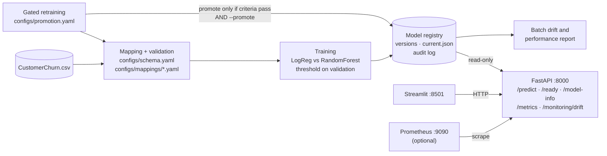
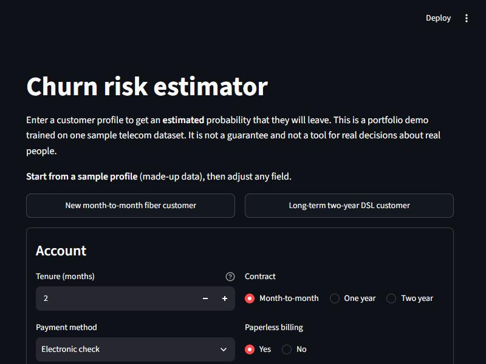
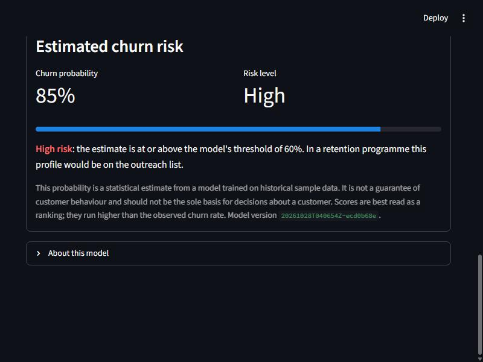
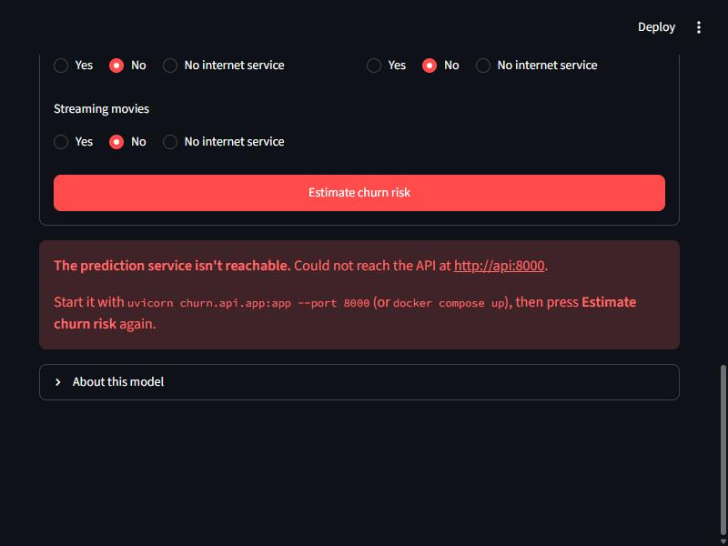

# Customer Churn Prediction: an end-to-end MLOps project

[](https://github.com/pranaypanchal22/churn-mlops/actions/workflows/ci.yml)

A local-first system that validates telecom customer data against a versioned schema, trains and
evaluates a churn classifier, serves it through a FastAPI service and a Streamlit UI, and monitors
and retrains it under explicit, audited promotion rules.

> **Portfolio and learning project.** It is trained on one sample dataset of fictional customers and
> is not intended or validated for decisions about real people.

| | |
|---|---|
| **Objective** | Show a reproducible, testable, deployable ML workflow, from raw CSV to monitored predictions, with the safeguards a real team would expect: schema contracts, leakage guards, honest evaluation, privacy-aware serving, and gated model promotion. |
| **Intended user** | Technical reviewers of the portfolio, and an imagined retention analyst who wants a ranked view of churn risk for outreach. |
| **Stack** | Python 3.11–3.13 · pandas · scikit-learn · Pydantic · FastAPI · Streamlit · pytest · ruff · Docker Compose · GitHub Actions · Prometheus client · MLflow (optional) |
| **Runs on** | One laptop. No cloud account, paid service, or credentials needed. |

## Architecture



Component detail, request flow, model lifecycle, and design decisions: [docs/architecture.md](docs/architecture.md).

## Data

| | |
|---|---|
| Source | Kaggle telecom churn archive (`CustomerChurn.csv`). Its columns match IBM's sample "Telco customer churn" dataset of **fictional** customers. |
| Licence | **Unknown, must be verified** on the Kaggle dataset page. The data is **not** in this repository. |
| Size | 7,043 rows, 21 columns. Target `Churn`: Yes 1,869 (26.5%), No 5,174 (73.5%). |
| Identifiers | `Customer ID` (unique) and `LoyaltyID` (22 values shared by 44 rows). Never used as features. |
| Quality findings | 11 blank `Total Charges`, all with tenure 0 (rule: set to 0.0). No other missing values. No full-row duplicates. 41 duplicates once IDs are removed, 20 of them with conflicting labels. |

To provide the data, copy `CustomerChurn.csv` **unchanged** to `data/raw/CustomerChurn.csv`. The expected
SHA-256 is `79e23e3dff5595612d4db00d3f783f07c87162ed987061c5ab516611d3de25d6`. More detail:
[data profile](docs/data_profile.md) · [data dictionary](docs/data_dictionary.md).

## Run it

### Option A: Docker (recommended)

```bash
cp .env.example .env
docker compose build
docker compose --profile tools run --rm trainer                    # train; prints the new VERSION
docker compose --profile tools run --rm trainer python scripts/promote.py --version <VERSION> --reason "initial baseline"
docker compose up -d                                               # UI http://localhost:8501 · API http://localhost:8000/docs
```

### Option B: local Python

```bash
python -m venv .venv
.venv/Scripts/python -m pip install -c requirements/constraints.txt -e ".[dev,frontend]"   # macOS/Linux: .venv/bin/python
.venv/Scripts/python scripts/train.py                                   # validates data, trains, registers (not served)
.venv/Scripts/python scripts/promote.py --version <VERSION> --reason "initial baseline"
.venv/Scripts/python -m uvicorn churn.api.app:app --port 8000          # terminal 1
.venv/Scripts/python -m streamlit run frontend/app.py                   # terminal 2 -> http://localhost:8501
.venv/Scripts/python -m pytest                                          # tests (no dataset needed)
```

Add the `tracking` extra for MLflow. With `make` installed, `make help` lists shortcuts for all of these.
There's no dataset yet? `make smoke` trains on synthetic data. Setup, configuration, and troubleshooting:
[operations runbook](docs/operations_runbook.md).

## Schema mapping: how new data sources get in

Raw files never reach the model directly. A versioned **mapping** translates a source's columns and
values into the **canonical schema**, and anything it can't account for is reported, not guessed.

```yaml
# configs/mappings/ibm_telco_v1.yaml (excerpt): a second file in the same archive
columns:
  tenure_months: [Tenure Months]     # Kaggle file calls it "Tenure"
  churn: [Churn Label]               # Kaggle file calls it "Churn"
  gender: [Gender]                   # optional, audit-only, never a feature
identifier_columns: [CustomerID]
excluded_columns: [Churn Value, Churn Score, CLTV, Churn Reason]   # outcome-derived = leakage
value_maps:
  contract: {Month-to-month: month_to_month, One year: one_year, Two year: two_year}
```

If a required field is missing, the run fails with the aliases it tried, the columns available, and
the YAML key to edit. An unexpected column is an error, and stays an error even in warn mode if its name
looks like an ID or outcome. Values outside the value map are errors. Both mappings validate their files, and they show
why matching must be explicit: `dependents` has the same name in both files, but different counts (2,110 vs
1,627 "yes"). [docs/schema_mapping.md](docs/schema_mapping.md)

## Evaluation: method and actual results

- Stratified 60/20/20 split with seed 42. Preprocessing is fit on train only, inside one sklearn
  `Pipeline` + `ColumnTransformer`. Unknown categories are ignored.
- Logistic Regression and Random Forest are compared on **validation** PR-AUC. Logistic Regression was
  selected (0.643 vs 0.628). That difference is small and comes from one split.
- **Operating goal for retention outreach:** catch at least 70% of churners, and among thresholds
  that do, pick the highest precision. A false negative is a missed churner, and lost revenue. A false positive is a wasted
  offer or contact. The threshold is chosen on validation (0.604). The test set was scored **once**.

| Split | ROC-AUC | PR-AUC | Precision | Recall | F1 | Flagged |
|---|---:|---:|---:|---:|---:|---:|
| Validation | 0.837 | 0.643 | 0.568 | 0.703 | 0.628 | 32.9% |
| **Test** | **0.842** | **0.634** | **0.549** | **0.709** | **0.618** | 34.3% |

On the test set, 265 of 374 churners were flagged, and about 55% of flagged customers actually churned (base
rate 26.5%). Training is reproducible: three host runs and one run in a Linux container gave
identical metrics, apart from floating-point noise around 1e-14. Subgroup results show the single
threshold misses almost all churners on one- and two-year contracts. See the
[model card](docs/model_card.md). Full method: [docs/model_evaluation.md](docs/model_evaluation.md).

## API

`GET /health` · `GET /ready` · `GET /model-info` · `POST /predict` · `POST /predict/batch` (≤100) ·
`GET /metrics` · `GET /monitoring/drift`

```bash
curl -s -X POST localhost:8000/predict -H "Content-Type: application/json" \
  -d @tests/fixtures/predict_request.json
```

```json
{
  "churn_probability": 0.8518,
  "risk_label": "high",
  "threshold": 0.6036834115455383,
  "model_version": "20261027T185356Z-9178da7c",
  "note": "This probability is a statistical estimate from a model trained on historical sample data. It is not a guarantee of customer behaviour and should not be the sole basis for decisions about a customer."
}
```

That response is real output from the first baseline. The served version `20261028T040654Z-ecd0b68e`
returns the same probability. Request validation is generated from the schema, and unknown fields such as
`customer_id` are rejected. Error bodies name the field but never echo the submitted value.
[docs/api.md](docs/api.md)

## Frontend

**1. Form, with a made-up sample profile preloaded**



**2. Result returned by the API**: probability, risk level, threshold, model version, and the estimate disclaimer



**3. API unavailable**: a clear message and how to recover



The form is built from the API's input schema, and every prediction goes through `POST /predict`.
There's no model code in the UI. It has made-up sample profiles, field-level API errors, and non-blocking
consistency hints. Checked at desktop width and at 375 px. [docs/frontend.md](docs/frontend.md)

## CI/CD and Docker

- **GitHub Actions** ([ci.yml](.github/workflows/ci.yml)) runs four jobs with no secrets:
  - pinned `ruff` lint and format check;
  - `pytest` with coverage on Python 3.11 and 3.13;
  - a synthetic-data smoke run: validate → train → promote → serve → `/predict`;
  - a Docker job that builds both images and checks the running stack.
- **Tests:** 119, all on synthetic or hand-built data. 95% line coverage across `churn` and `frontend`
  (Windows, Python 3.13). The same suite passes on Linux with Python 3.11.
- **Docker:**
  - multi-stage `python:3.11-slim` images that run as non-root (uid 10001), with health checks;
  - compose adds read-only root filesystems, drops all Linux capabilities, sets `no-new-privileges` and memory limits;
  - the model registry is mounted **read-only** into the API.

  Images are 742 MB (API) and 818 MB (UI).

[docs/testing_ci.md](docs/testing_ci.md) · [docs/operations_runbook.md](docs/operations_runbook.md)

## Monitoring and retraining

- JSON logs and Prometheus metrics (requests, latency, validation errors, score distribution) carry
  **no request payloads**. Live drift keeps only aggregate bin counts.
- Drift (PSI against a training-time reference profile) is reported **separately** from
  performance. Performance is only computed when outcome labels exist.
  - On real data, a random 1,000-row batch returned `ok`.
  - A batch of new month-to-month customers returned `alert` (tenure PSI 5.0, flagged 66.9% vs 32.9%), with performance
    explicitly "not measured".
- **Gated retraining:** validate the new data → train a candidate → compare it with the served model on the same rows
  → check 7 policy criteria → promote **only** with `--promote`. Every decision is recorded. A dry run on
  the real data gave `eligible_not_promoted` and left serving unchanged.
- An optional Prometheus profile ships 5 alert rules (model not ready, 5xx rate, latency, feature drift,
  score drift).

[docs/monitoring.md](docs/monitoring.md)

## Limitations and responsible use

- **Single, fictional, single-period dataset.** Nothing here shows the model generalises to any real
  provider, market, or time.
- **The licence is unverified.** Check it before redistributing anything derived from the data.
- One split without confidence intervals or hyperparameter search. Probabilities are uncalibrated and run
  high (mean 0.41 vs base rate 0.265).
- The 70% recall goal is an assumption. Real offer costs and customer values aren't in the data.
- One global threshold serves segments very unevenly: recall is 0.79 on month-to-month contracts,
  0.11 on one-year, and 0 on two-year. `senior_citizen`, an age-related attribute, is a model input.
- Model signals (permutation importance) describe what the model relies on. They are **not causes**, and
  not per-customer explanations.
- Drift alerts mean "the inputs changed", not "the model got worse".

## Future extensions (not implemented)

- Probability calibration, per-segment thresholds, and a cost-weighted threshold, once real costs are known
- Cross-validation with confidence intervals, and hyperparameter search
- Fairness audit on a source with `gender` (the mapping and audit role already exist)
- Fully hashed dependency lock (`uv`/`pip-tools`) and smaller images
- Hot model reload after promotion (today the API needs a restart)
- Durable store for live monitoring counts, a Grafana dashboard, and Alertmanager notifications
- Scheduled retraining dry runs (e.g. a scheduled GitHub Actions job without `--promote`)
- Cloud deployment, object-storage registry, remote MLflow server

## Documentation

| Doc | Contents |
|---|---|
| [architecture.md](docs/architecture.md) | Components, request flow, model lifecycle, design decisions |
| [data_profile.md](docs/data_profile.md) | Source, licence status, data quality findings |
| [data_dictionary.md](docs/data_dictionary.md) | Canonical fields, source columns, value counts, excluded columns |
| [schema_mapping.md](docs/schema_mapping.md) | Validation rules and onboarding a new source |
| [model_evaluation.md](docs/model_evaluation.md) | Method, results, error trade-offs |
| [model_card.md](docs/model_card.md) | Intended use, subgroup results, caveats |
| [api.md](docs/api.md) · [frontend.md](docs/frontend.md) | Service contract and UI behaviour |
| [testing_ci.md](docs/testing_ci.md) | Test coverage, pinning, CI jobs |
| [monitoring.md](docs/monitoring.md) | Metrics, drift vs performance, gated retraining |
| [operations_runbook.md](docs/operations_runbook.md) | Setup, configuration, routine tasks, troubleshooting |
| [project_status.md](docs/project_status.md) | Acceptance criteria with evidence, implemented vs future work |
