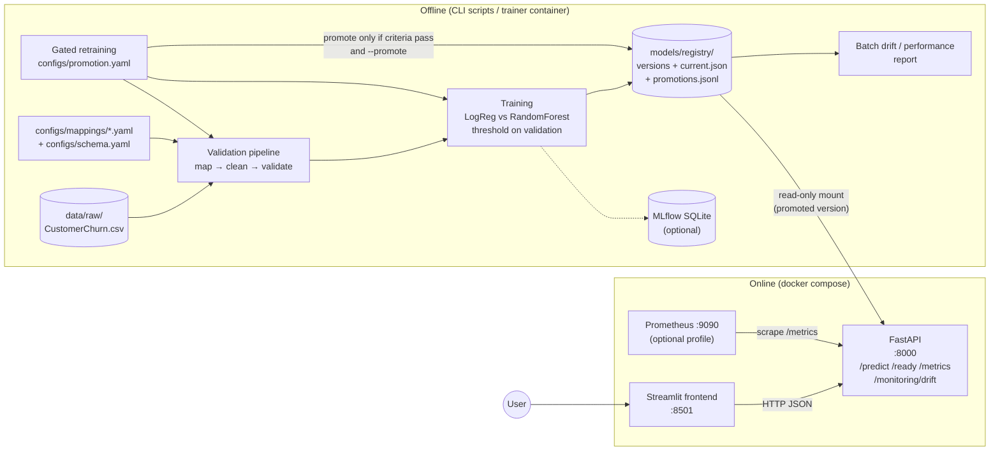
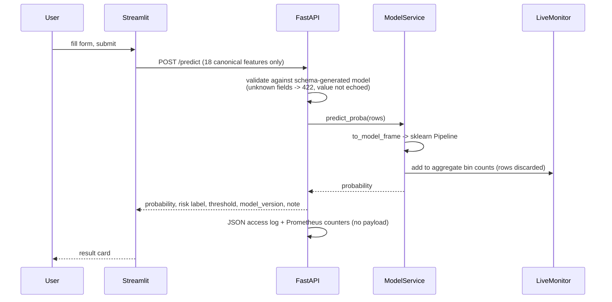
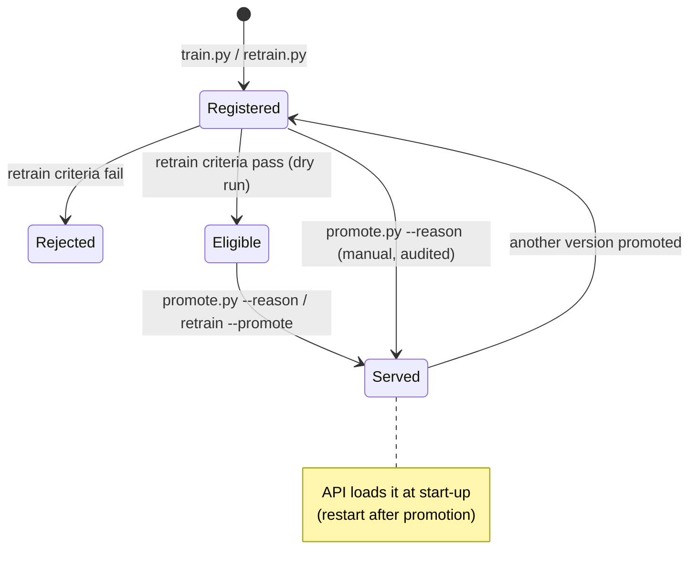

# Architecture

## Components



| Component | Code | Responsibility |
|---|---|---|
| Canonical schema | `configs/schema.yaml`, `src/churn/schema/config.py` | The one contract for feature names, types, ranges, and allowed values. Also lists forbidden source-name patterns. |
| Source mappings | `configs/mappings/*.yaml` | Per-source column aliases, value maps, identifier/excluded/ignored columns, and cleaning rules |
| Validation pipeline | `src/churn/data/pipeline.py` | Turns raw tables into canonical ones and collects every issue into a versioned report |
| Training | `src/churn/features/build.py`, `src/churn/models/{train,evaluate}.py` | Leakage guard, one sklearn Pipeline, candidate comparison, threshold choice, and the single test evaluation |
| Registry | `src/churn/models/registry.py` | Immutable, hash-checked versions, the `current.json` pointer, and an append-only audit log |
| API | `src/churn/api/` | Request validation generated from the schema, predictions, readiness, metrics, and live drift |
| Frontend | `frontend/` | Form built from `/model-info`. Talks to the API over HTTP only. |
| Monitoring | `src/churn/monitoring/`, `monitoring/` | Reference profiles, PSI drift, batch reports, Prometheus rules |
| Retraining | `src/churn/models/retrain.py` | Validate → candidate → compare → gate → explicit promotion |

## Request path



## Model lifecycle



Nothing becomes the served model without an explicit command, and every decision is appended to
`models/registry/promotions.jsonl`.

## Design decisions

| Decision | Why |
|---|---|
| Raw schema kept separate from the canonical schema, with an explicit YAML mapping | New sources need a reviewed mapping. Same-named columns can mean different things (`dependents` differs between the two files in the archive). |
| All preprocessing inside one sklearn `Pipeline` | Fit on training rows only, and shipped as one artifact, so training and serving can't diverge |
| Category levels come from the schema, with `handle_unknown="ignore"` | The encoded layout stays the same across retrains, and unexpected values at serving time don't crash |
| Threshold chosen on validation with a stated goal | Turning a score into an action is a business choice. The test set is used once, only to report results. |
| File-based registry and promotion pointer | Runs locally without services. Promotion is a visible, audited file change. |
| Models mounted read-only into the API | The serving process can't change what it serves |
| Request validation generated from the schema, plus a schema-version check at load | The API and the training data share one definition of valid input |
| Drift stored as aggregate counts only | Monitoring without keeping customer-level records |
| Drift reported separately from performance | Drift is not degradation, and performance needs outcomes |
| MLflow and Prometheus optional | The core project runs with nothing but Python or Docker |

## Repository layout

```
configs/            schema, source mappings, training, monitoring, promotion policy
src/churn/          library code: schema, data, features, models, api, monitoring
frontend/           Streamlit app (own requirements; no model code)
scripts/            CLI entry points: profile, prepare, train, promote, retrain, drift_report
tests/              pytest suite (synthetic data only)
docker/             API and frontend Dockerfiles
monitoring/         Prometheus scrape config and alert rules
docs/               this documentation
data/ models/ reports/   local only, gitignored
```
